```{r}
#| label: setup
#| include: false
#| message: false
#| warning: false

library(dplyr)
library(tidyr)
library(htmltools)
source("R/widgets-v2.R")

knitr::opts_chunk$set(echo = TRUE, message = FALSE, warning = FALSE)
options(dplyr.summarise.inform = FALSE)

out <- readRDS("data/pipeline_v2.rds")

# --- formatowanie (polski przecinek dziesiętny) ---
fmt <- function(x, d = 1) formatC(as.numeric(x), format = "f", digits = d, decimal.mark = ",")
pct <- function(x, d = 1) paste0(fmt(x, d), "%")

# --- kafelki KPI (stat tiles) ---
kpi_card <- function(label, value, note = NULL) {
  as.character(tags$div(
    class = "kpi-card",
    tags$div(class = "kpi-label", label),
    tags$div(class = "kpi-value", HTML(value)),
    if (!is.null(note)) tags$div(class = "kpi-note", HTML(note))
  ))
}
kpi_row <- function(...) {
  HTML(paste0("<div class=\"kpi-grid\">", paste0(..., collapse = ""), "</div>"))
}

# --- kluczowe liczby liczone z RDS (nigdy z v1 RAPORT.md) ---
ladder <- out$loo_ladder_summary
e3 <- ladder[ladder$estimator_id == "E3", ]
e5 <- ladder[ladder$estimator_id == "E5", ]

fit_price <- lm(quality ~ log10(blend_cost),
                data = out$quality_df %>% filter(is.finite(blend_cost), blend_cost > 0))
slope10x  <- unname(coef(fit_price)[2])
r2_price  <- summary(fit_price)$r.squared

m14 <- out$missingness_14_df
pct_missing_14 <- 100 * sum(m14$n_missing) / sum(m14$n_measured + m14$n_missing)
pct_missing_9  <- 100 * sum(m14$n_missing[m14$is_target_9]) /
                  sum(m14$n_measured[m14$is_target_9] + m14$n_missing[m14$is_target_9])

es <- out$effort_summary_df
med_delta <- function(m) es$med_delta[es$metric == m]

gems_df <- out$per_model_spe %>%
  filter(is.finite(med_spe), n_m >= 3) %>%
  arrange(med_spe)
overrated_df <- out$per_model_spe %>%
  filter(is.finite(med_spe), n_m >= 3) %>%
  arrange(desc(med_spe))

q_pro  <- out$quality_df[out$quality_df$model_id == "xiaomi/mimo-v2.6-pro", ]
q_muse <- out$quality_df[out$quality_df$model_id == "meta/muse-spark-1.3", ]

# bieżący stack Fenixa Mateusza
my_stack <- c("z-ai/glm-5.3-flash", "xiaomi/mimo-v2.6-pro", "z-ai/glm-5.3",
              "anthropic/claude-sonnet-4-6", "openai/gpt-5.4")
stack_df <- out$quality_df %>% filter(model_id %in% my_stack) %>%
  select(model_id, quality, resid, med_spe, blend_cost, n_meas_7)
```

# Rozdział 1 — Prolog: Dlaczego powstał ten projekt

To jest projekt **Data Scientist po godzinach**. Po dniu pracy z danymi zauważyłem, że tęsknię za tym, co kiedyś lubiłem najbardziej: otwarciem surowego, publicznego zbioru danych i klasyczną eksploracją statystyczną — rozkładami, brakami danych, korelacjami, regresją. Nie dashboardem, nie „AI ubezpieczonym cudzysłowem" — tylko zwykłą, rzetelną analizą. Zamiast wracać do irysów, wziąłem zbiór, który na co dzień kupuję za własne pieniądze: **publiczne dane o modelach LLM** z katalogów **OpenRouter** i **Artificial Analysis (AA)**.

```{r}
#| label: hero-kpi
#| echo: false
#| results: asis
kpi_row(
  kpi_card("Ocenione modele", as.character(out$meta$n_models),
           paste0("+", nrow(out$unscored), " bez ocen (tylko cenniki)")),
  kpi_card("Benchmarki AA", "14", "9 celów + 5 predyktorów"),
  kpi_card("Mediana błędu LOO |SPE| (E5)", pct(e5$med_abs_spe),
           paste0("Pearson r = ", fmt(e5$pearson_r, 3), " · 1056 komórek")),
  kpi_card("Cena vs jakość", paste0("~", fmt(slope10x, 0), " pkt / 10×"),
           paste0("R² ≈ ", pct(100 * r2_price, 0), " wariancji ceny"))
)
```

Zebrałem **353 modele** — `212` z pomiarami benchmarków i `141` z samymi cennikami — co daje `390` wierszy model × wariant w 14 benchmarkach AA. I wtedy okazało się, że **naiwny ranking nie działa**. Trzy powody:

**1. Pułapka uśredniania wariantów (`reasoning effort`).** Ten sam model bywa testowany w trybach `low`, `medium`, `high`, `max`. Uśrednienie tych wyników po równo karze modele, które ekspozycjonują tanie, szybkie tryby — ich średnia spada, choć ich najlepszy wariant jest świetny. v2 porządkuje to hierarchią wariantu flagowego (`max > xhigh > high > on > default > medium > low > minimal > off`).

**2. Nieprzypadkowe braki danych (MNAR — Missing Not At Random).** W 9 benchmarkach docelowych brakuje `r pct_missing_9` komórek (a `r pct(pct_missing_14)` w całej czternastce) — i to nie jest szum losowy. Tańsi i mniejsi dostawcy po prostu **nie uruchamiają drogich zestawów agentowych i kodowych**. Brak danych niesie informację o pozycji rynkowej modelu, więc ignorowanie go (albo wypełnianie medianą) fałszuje ranking w sposób systematyczny.

**3. Brak wspólnego mianownika dla ról wieloagentowych.** Wybór modeli „po hype" albo po jednym indeksie podsumowującym ignoruje dwie rzeczy, które w praktyce budują system wieloagentowy: **surplus jakości do ceny** oraz **specjalizację ról**. Inny model pisze kod, inny audytuje, inny klika po CLI — i każdy z tych profilów ma inną krzywą ceny.

Ten raport buduje odpowiedź na wszystkie trzy problemy: warianty flagowe zamiast średniej (`Rozdział 2`), skrośny estymator braków `E5` walidowany LOO (`Rozdział 3–4`), detektor anomalii jakościowych (`Rozdział 5`), taksonomię rynku (`Rozdział 6`), ekonomię i podwójną frontierę Pareto (`Rozdział 7`) oraz rekomendacje KPI dla systemu wieloagentowego Fenix (`Rozdział 8`).

# Rozdział 2 — Architektura danych, 14 benchmarków i drabina nakładu rozumowania

## 14 benchmarków: 9 celów + 5 predyktorów

Analiza dzieli 14 benchmarków AA na dwie grupy:

- **9 metryk docelowych** — te estymujemy i rekomendujemy: `intel` (inteligencja ogólna), `code` (kod), `agent` (agentic), `py` (Python), `term` (terminal/CLI), `ifb` (instrukcje/format), `lctx` (długi kontekst), `econ` (ekonomia/logika biznesowa), `hon` (uleczalność halucynacji).
- **5 predyktorów pomocniczych** — `hle`, `phys`, `gpqa`, `tau2`, `know`. Są mierzone u większej liczby dostawców i służą do **przewidywania** braków w metrykach docelowych.

```{r}
#| label: missingness-table
#| echo: false
m14 %>%
  transmute(
    Metryka = label_pl,
    `Cel (9)` = ifelse(is_target_9, "tak", "—"),
    `Zmierzone` = n_measured,
    `Braki` = n_missing,
    `Pokrycie` = pct(100 * pct_measured)
  ) %>% as.data.frame()
```

Braki w 9 metrykach docelowych są **nieprzypadkowe** — to nie losowe dziury, tylko ślad struktury rynku: drogie zestawy testów kupują duzi. Strukturalne wzorce braków (kolumny pomiaru współwystępujące u tych samych modeli):

```{r}
#| label: patterns-table
#| echo: false
out$patterns_df %>%
  transmute(Wzorzec = pattern, Modele = n_models,
            `Metryk zmierzonych` = n_metrics_measured,
            Przykłady = example_models) %>% as.data.frame()
```

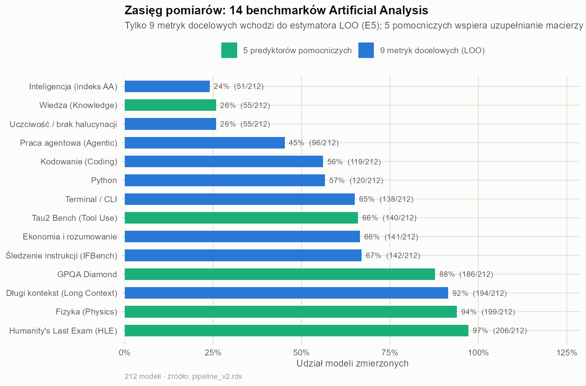

## Hierarchia wariantu flagowego i kara uśredniania

v1 liczył średnią po wszystkich wariantach. v2 wybiera **wariant flagowy** wg hierarchii `max > xhigh > high > on > default > medium > low > minimal > off`. Kara za uśrednianie jest mierzalna — dla modeli z wieloma wariantami:

```{r}
#| label: variant-penalty
#| echo: false
out$variant_penalty_df %>%
  arrange(desc(variant_penalty)) %>%
  head(10) %>%
  transmute(Model = model_id, `Metryk` = n_metrics,
            `Śr. wariant flagowy` = fmt(mean_flagship_score),
            `Śr. po wszystkich wariantach` = fmt(mean_variant_score),
            `Kara uśredniania` = fmt(variant_penalty)) %>% as.data.frame()
```

## Drabina nakładu rozumowania (Reasoning Effort)

Ile daje podniesienie wysiłku rozumowania z `low` na `high`? Mediana zysku punktowego na metrykę:

```{r}
#| label: effort-table
#| echo: false
es %>%
  transmute(Metryka = label_pl, `Par (low→high)` = n_multivariant,
            `Med. low` = fmt(med_low), `Med. high` = fmt(med_high),
            `Zysk med.` = paste0("+", fmt(med_delta)),
            IQR = fmt(iqr_delta)) %>% as.data.frame()
```

Dla metryk wiedzowo-intelektualnych skok jest duży: `gpqa` **+`r fmt(med_delta("gpqa"))`** pkt, `intel` **+`r fmt(med_delta("intel"))`** pkt; dla kodu `code` **+`r fmt(med_delta("code"))`** pkt. Wniosek praktyczny: **drabina effort to darmowy przyrost jakości** — zanim dopłacisz za większy model, dopłać za tokeny rozumowania tego, który już masz.

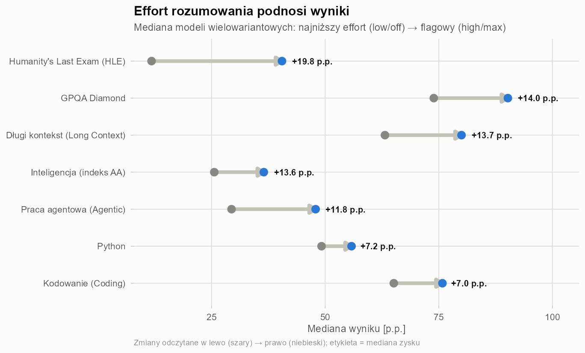

# Rozdział 3 — Metodologia imputacji braków: od naiwnej mediany (E0) do ważonego zespołu R² (E5)

## Problem

Mamy macierz modeli × metryki, w której `r pct(pct_missing_9)` komórek w metrykach docelowych jest pusta. Chcemy wypełnić braki **estymatą** $\hat{y}$ taką, żeby błąd względem prawdziwego wyniku $y$ był mały i — co ważniejsze — **nieobciążony systematycznie** względem ceny modelu.

## SPE: symetryczny błąd procentowy

Jakość estymacji mierzymy symetrycznym błędem procentowym:

$$\text{SPE}(E, A) = \frac{200 \cdot (E - A)}{|E| + |A|}$$

gdzie $E$ to estymata, a $A$ — rzeczywisty wynik. SPE jest **ograniczony do ±200%** (nie wybucha dla małych mianowników), **symetryczny** (błąd 2× w górę = błąd 2× w dół) i **inwariantny skalowo** między benchmarkami o różnych sufitach punktowych. Liczy się **znak**:

- $\text{SPE} < 0 \iff A > E$ — **model bije estymatę**: wypada lepiej, niż wynikałoby z jego innych testów. Potencjalna ukryta perełka.
- $\text{SPE} > 0 \iff E > A$ — **model poniżej oczekiwań**: jego wyniki w innych testach sugerowały więcej. Przeszacowany.

## Drabina estymatorów: E0 → E5

| Estymator | Metoda |
|---|---|
| **E0** | mediana globalna metryki (dno — ignoruje model) |
| **E1** | mediana dostawcy (autorska „rodzina" modeli jest spójna) |
| **E2** | pary ilorazów względem zmierzonych metryk |
| **E3** | nieważony basen 9 metryk docelowych — **baseline v1** |
| **E4** | pairwise OLS (regresje parami metryk) |
| **E5** | **zespół ważony R²: top-4 predyktory, 14 metryk — v2** |

Dlaczego **E5** działa: spośród 14 benchmarków wybiera jako predyktory tylko te, które mają $R^2 \ge 0{,}30$ względem metryki docelowej; regresje OLS ważą $(R^2)^2$, a ilorazy parami $0{,}5\,(R^2)^2$. Dzięki temu predyktory z pełnego zbioru — `gpqa`, `hle`, `phys`, `tau2`, `know` — pomagają przewidywać braki w `code`, `agent`, `py`. Dla metryk ortogonalnych (np. `hon`, gdzie maksymalne $R^2 \approx 0{,}14$) E5 wraca do E1 — lepiej słaba estymata, niż zła regresja.

# Rozdział 4 — Walidacja Leave-One-Out (LOO CV) na 1056 pomiarach i korekta obciążenia cenowego

## Protokół

Protokół walidacji jest brutalnie prosty: dla każdej z **1056 zmierzonych komórek** w 9 metrykach docelowych ukrywamy jej wartość, liczymy estymatę z reszty danych i porównujemy z prawdą przez SPE. To Leave-One-Out cross-validation na całym zbiorze — bez żonglowania podziałami train/test, bo każdy punkt raz bycia testem.

## Drabina dokładności: E0 → E5

```{r}
#| label: ladder-table
#| echo: false
ladder %>%
  transmute(
    ID = estimator_id, Estymator = estimator_label_pl, `Komórek` = n_cells,
    `Med. |SPE|` = paste0(pct(med_abs_spe)), `IQR |SPE|` = pct(iqr_abs_spe),
    MAE = fmt(mae, 2), `RMSE` = fmt(rmse, 2),
    `r` = fmt(pearson_r, 3), `Obc. cenowe` = fmt(price_bias_r, 3)
  ) %>% as.data.frame()
```

Skok z E3 do E5 to **cała historia tego projektu w jednym wierszu**: mediana |SPE| spada z `r pct(e3$med_abs_spe)` do `r pct(e5$med_abs_spe)`, MAE z `r fmt(e3$mae, 2)` do `r fmt(e5$mae, 2)`, a korelacja rośnie z `r fmt(e3$pearson_r, 3)` do `r fmt(e5$pearson_r, 3)`.

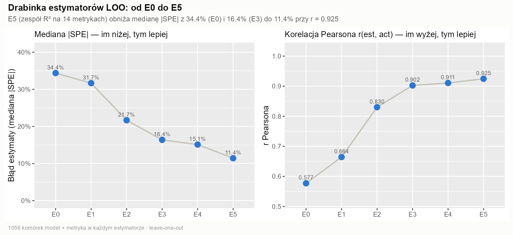

## Kalibracja per metryka

```{r}
#| label: per-metric-table
#| echo: false
out$loo_per_metric %>%
  transmute(
    Metryka = label_pl, N = n,
    `E3 med. |SPE|` = pct(med_abs_spe_e3),
    `E5 med. |SPE|` = pct(med_abs_spe_e5),
    `MAE E5` = fmt(mae_e5, 2),
    `Obciążenie E5` = pct(med_spe_e5),
    `r E5` = fmt(corr_e5, 3),
    `Max R² pred.` = fmt(mean_r2_max, 2)
  ) %>% as.data.frame()
```

Metryki **ściśle sprzężone** z resztą benchmarków estymują się znakomicie: `intel` (`r pct(out$loo_per_metric$med_abs_spe_e5[out$loo_per_metric$metric == "intel"])`), `py` (`r pct(out$loo_per_metric$med_abs_spe_e5[out$loo_per_metric$metric == "py"])`), `agent` (`r pct(out$loo_per_metric$med_abs_spe_e5[out$loo_per_metric$metric == "agent"])`), `code` (`r pct(out$loo_per_metric$med_abs_spe_e5[out$loo_per_metric$metric == "code"])`), `econ` (`r pct(out$loo_per_metric$med_abs_spe_e5[out$loo_per_metric$metric == "econ"])`), `lctx` (`r pct(out$loo_per_metric$med_abs_spe_e5[out$loo_per_metric$metric == "lctx"])`). Trudniejsze są `term`, `ifb` i `hon` — a `hon` jest wręcz ortogonalne: halucynacje nie wynikają z „ogólnej inteligencji", więc estymator świadomie wraca tam do mediana dostawcy.

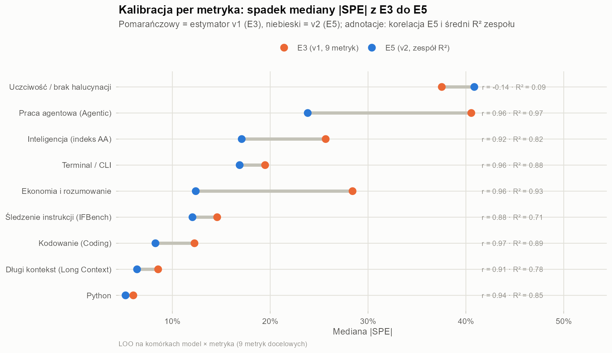

## Odkrycie: obciążenie cenowe

Najważniejszy efekt uboczny LOO: **obciążenie cenowe** — korelacja residuów z log-ceną. Nieważone baseny globalne systematycznie **przeszacowują ultratańskie modele** (pokrywają ich braki wynikami lepszych sąsiadów). Po drabinie korelacja spada z `r fmt(ladder$price_bias_r[ladder$estimator_id == "E3"], 2)` (E3) do `r fmt(e5$price_bias_r, 2)` (E5). Dlatego rekomendacje w `Rozdział 8` podają przedziały niepewności `[val_low, val_high]` — decyzja cenowa nigdy nie opiera na jednej liczbie punktowej.

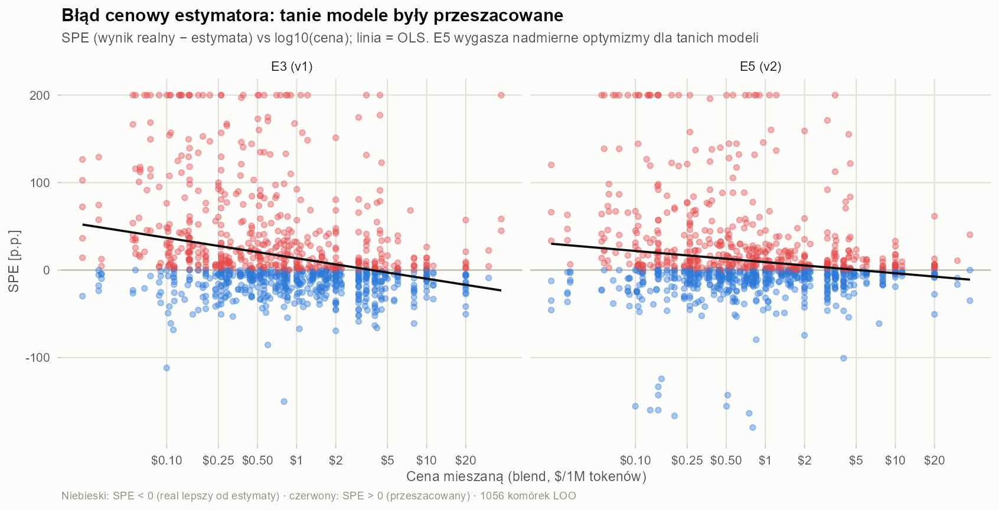

# Rozdział 5 — Ukryte perełki (SPE < 0) kontra modele przeszacowane (SPE > 0)

Gdy estymator jest bezstronny i skrośnie walidowany, jego **residua przestają być śmieciami — stają się sygnałem**. Dla każdego modelu liczymy `med_spe`: medianę $\text{SPE}$ między jego rzeczywistymi wynikami a estymatami E5 z innych jego testów. To **detektor anomalii**:

- **`med_spe < 0`** — model wypada **lepiej**, niż każe przypuszczać jego profil. Ukryta perełka: rynek (i cennik) jej jeszcze nie wycenił.
- **`med_spe > 0`** — model wypada **gorzej** niż jego inne wyniki. Przeszacowany: jego reputacja opiera się na wybranych benchmarkach, które przesłaniają słabsze metryki.

```{r}
#| label: gems-table
#| echo: false
gems_df %>%
  head(12) %>%
  transmute(Model = model_id, `Med. SPE` = paste0("−", pct(abs(med_spe))),
            `Pomiarów (7m)` = n_m, `Cena $/1M` = paste0("$", fmt(blend_cost, 2)),
            `Moje?` = ifelse(mine == 1, "TAK", "")) %>% as.data.frame()
```

```{r}
#| label: overrated-table
#| echo: false
overrated_df %>%
  head(10) %>%
  transmute(Model = model_id, `Med. SPE` = paste0("+", pct(med_spe)),
            `Pomiarów (7m)` = n_m, `Cena $/1M` = paste0("$", fmt(blend_cost, 2))) %>% as.data.frame()
```

Absolutnym liderem niedoszacowania jest `r gems_df$model_id[1]` (med. SPE `r paste0("−", pct(abs(gems_df$med_spe[1])))`) — a wśród perełek lądują też modele z mojego własnego stacka: `z-ai/glm-5.2`, `xiaomi/mimo-v2.6-pro`, `z-ai/glm-5.3` (ich siła koncentruje się w profilu agentowym, co widać na heatmapie poniżej).

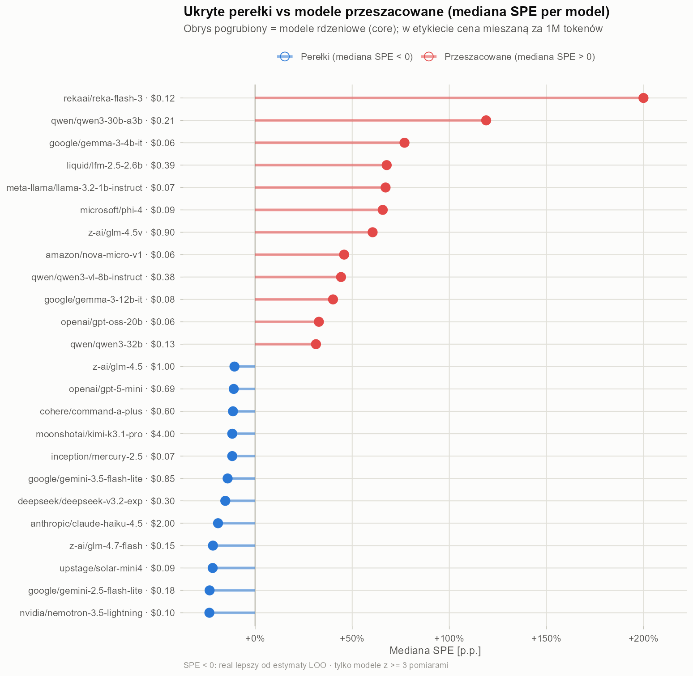

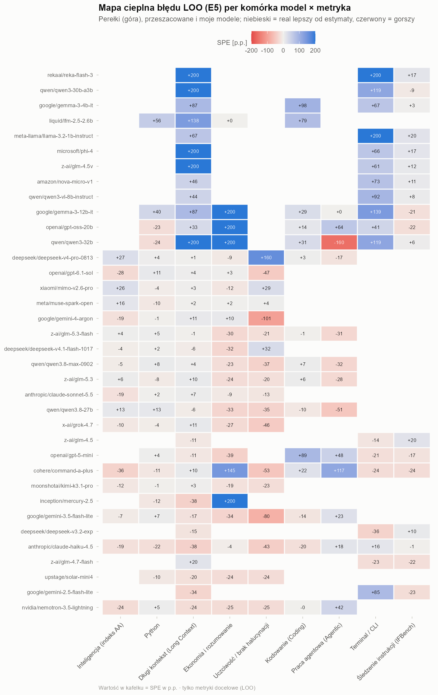

# Rozdział 6 — Taksonomia rynku: klastrowanie poziomu (Level) i kształtu specjalizacji (Shape)

Do profilowania strukturalnego używamy **METRICS_7** = `code, agent, py, term, ifb, lctx, econ` — bez kompozytu `intel` (który jest średnią i podwajałby sygnał) i bez ortogonalnego `hon` (który nie koreluje z niczym). Standaryzacja w kolumnach ($Z$) i t-SNE do rzutowania.

- **Klastrowanie poziomu (Level)**: $Z$ bezpośrednio, $K=2$ — separuje liderów jakości od modeli budżetowych.
- **Klastrowanie kształtu (Shape)**: $Z_s = Z - \bar{Z}_i$ (usuwamy średnią modelu), $K=2$ — co zostaje, to **specjalizacja**: profil agentowo-analityczny (`agent + econ`) vs profil instrukcyjno-kontekstowy (`ifb + lctx`).

```{r}
#| label: cluster-table
#| echo: false
out$cluster_meta %>%
  transmute(Tryb = mode, Klaster = cluster, Etykieta = cluster_label,
            Modeli = n_models, `Śr. jakość` = fmt(mean_quality),
            `Śr. cena $/1M` = paste0("$", fmt(mean_blend_cost, 2))) %>% as.data.frame()

out$silhouette_df %>% transmute(Tryb = mode, K = k, `Śr. sylwetka` = fmt(mean_sil, 3)) %>% as.data.frame()
```

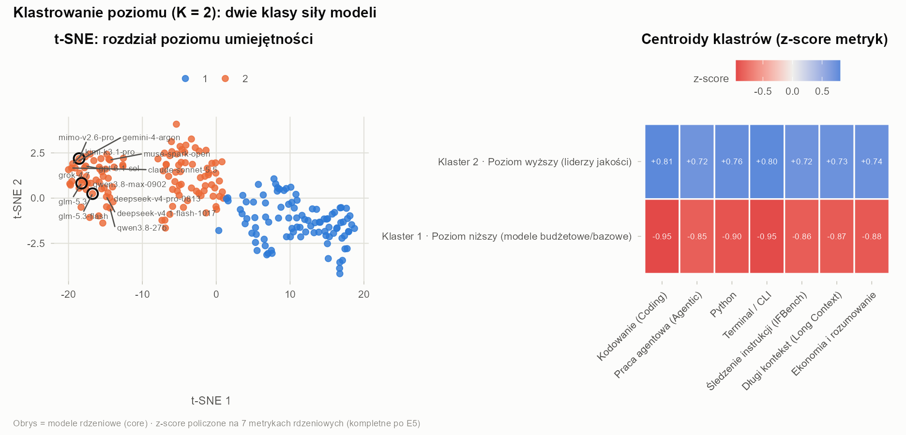

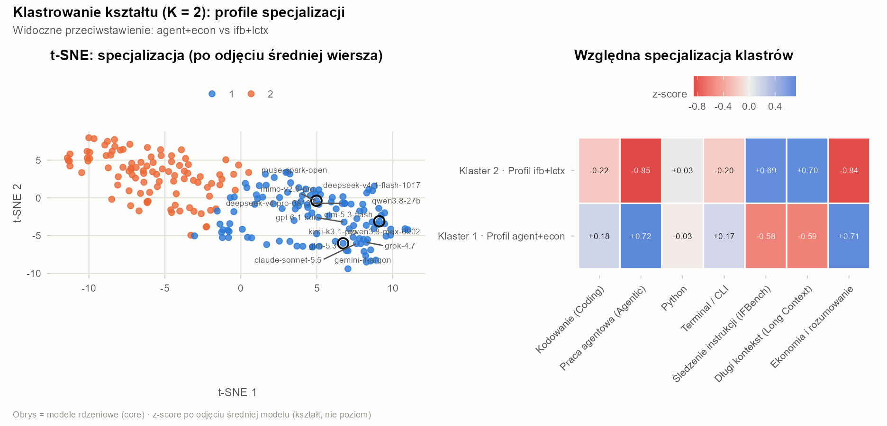

### Interaktywny eksplorator klastrów

Kliknij w punkt, żeby zobaczyć model, jego cenę i dwie najmocniejsze metryki:

::: {.panel-tabset}
## Kształt (specjalizacja)

```{r}
#| label: widget-clusters-shape
#| echo: false
widget_clusters_plotly(out, "shape")
```

## Poziom (jakość)

```{r}
#| label: widget-clusters-level
#| echo: false
widget_clusters_plotly(out, "level")
```
:::

# Rozdział 7 — Ekonomia cen, wartość naddana (Value Surplus) i podwójna frontiera Pareto

## Cena kupuje mniej, niż myślisz

Regresja jakości na log-cenie:

$$\text{quality} \sim \log_{10}(\text{blend\_cost})$$

```{r}
#| label: price-lm
#| echo: false
coef(summary(fit_price))[, 1:2]
round(summary(fit_price)$r.squared, 3)
```

**`10×` wyższa cena kupuje średnio `r fmt(slope10x, 0)` punktów percentylowych jakości — i wyjaśnia tylko `r pct(100 * r2_price, 0)` wariancji.** Pozostałe ~75% to architektura, kwantyzacja i inżynieria dostawcy. To jest najważniejsza liczba ekonomiczna tego raportu: rynek LLM **nie jest rynkiem komoditowym** — drogo ≠ lepiej, i tanio ≠ słabo.

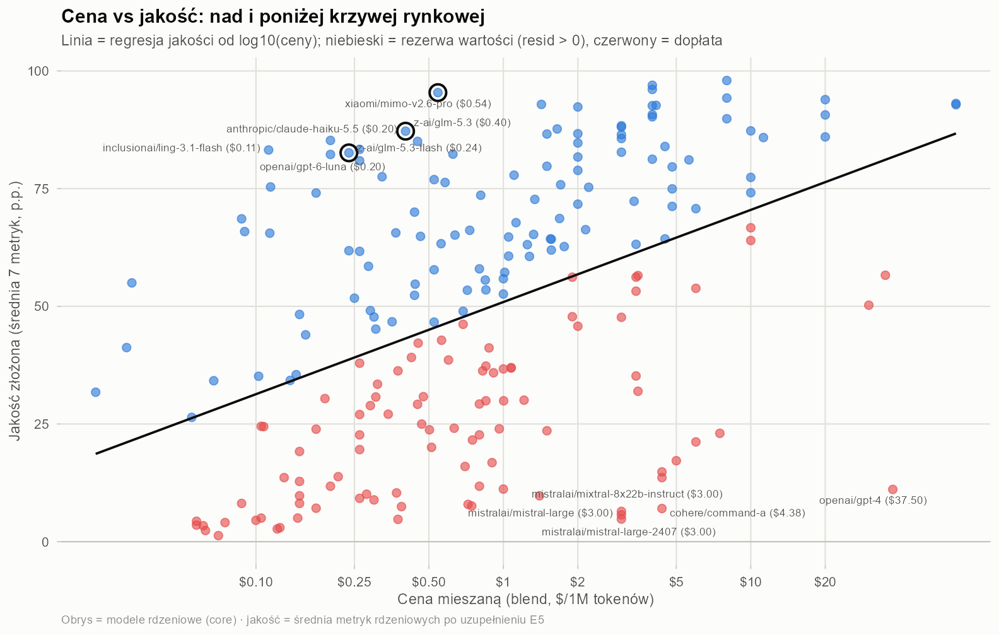

Które umiejętności są najdroższe w kupowaniu, a które już skomodytyzowano?

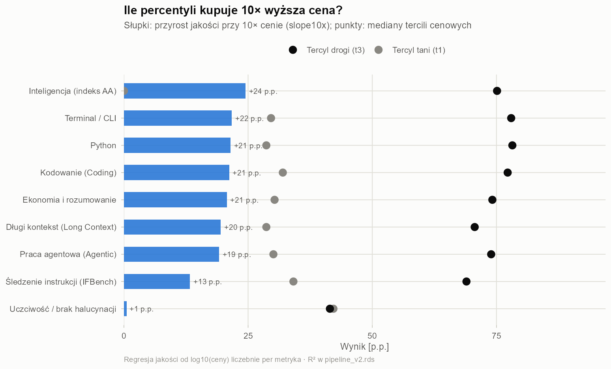

## Podwójna frontiera Pareto

Frontiera liczona jest w dwóch wersjach: **wszystkie modele** (`pareto_all`) oraz **zweryfikowani** (`pareto_verified` — wymagane ≥ 5 z 7 zmierzonych metryk METRICS_7). Różnica między nimi to w praktyce **ryzyko estymacji**: model z 3 pomiarami może być na fronterze tylko dlatego, że jego braki zostały optymistycznie imputowane.

Studium przypadku: `xiaomi/mimo-v2.6-pro` — `r paste0(q_pro$n_meas_7, "/7")` zmierzonych metryk za `$`r fmt(q_pro$blend_cost, 2)`/1M — versus `meta/muse-spark-1.3`: `r paste0(q_muse$n_meas_7, "/7")` zmierzonych za `$`r fmt(q_muse$blend_cost, 2)`/1M. Oba są świetne, ale **pewność ich pozycji jest zupełnie różna** — i dokładnie to pokazuje rozdział „all vs verified".

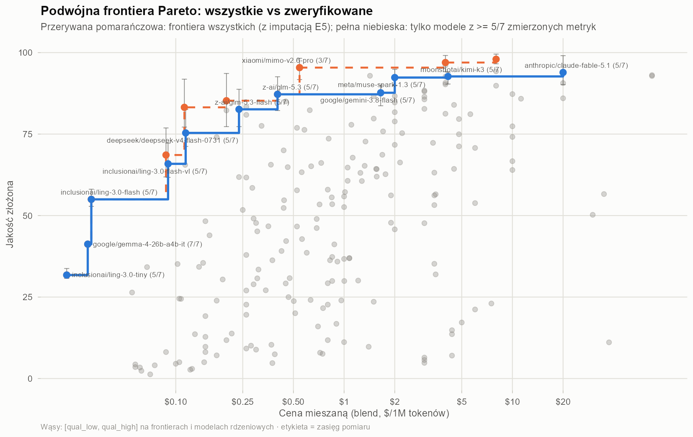

### Interaktywna frontiera

```{r}
#| label: widget-pareto
#| echo: false
widget_pareto_plotly(out)
```

## Kwadrant syntezy: prawdziwe ukryte perełki

Dwie osie anomalii: `med_spe < 0` (model bije estymator) **oraz** `resid > 0` (jakość ponad krzywą cenową). Model w obu naraz to **prawdziwa Hidden Gem** — bije zarówno statystykę, jak i rynek.

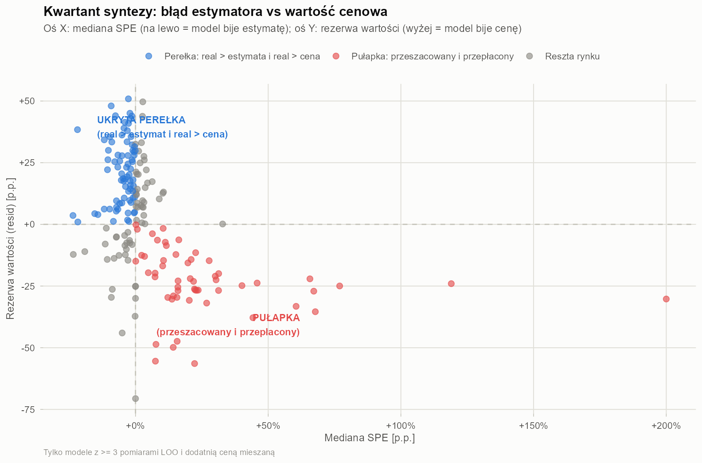

### Interaktywny kwadrant

```{r}
#| label: widget-gems
#| echo: false
widget_gems_quadrant_plotly(out)
```

# Rozdział 8 — Rekomendacje KPI dla systemu wieloagentowego Fenix (DEV, REVIEW, TEST) oraz pełny katalog modeli

Cała maszyna analityczna tego raportu ma jeden cel: wybrać modele do **Fenixa** — naszego systemu wieloagentowej inżynierii oprogramowania, w którym role mają **odmienne, mierzalne wymagania statystyczne**:

- **`DEV`** (`code + py + agent`) — pisze kod produkcyjny i prowadzi pętle narzędziowe agenta.
- **`REVIEW`** (`ifb + hon + code`) — audytuje diffy wobec ścisłych reguł (`ifb`), nie halucynuje fałszywych defektów (`hon`), rozumie kod (`code`).
- **`TEST`** (`term + agent + ifb`) — wykonuje weryfikacyjne zestawy CLI (`term`), nawiguje wieloetapowe harnessy (`agent`), trzyma się checklist weryfikacyjnych (`ifb`).

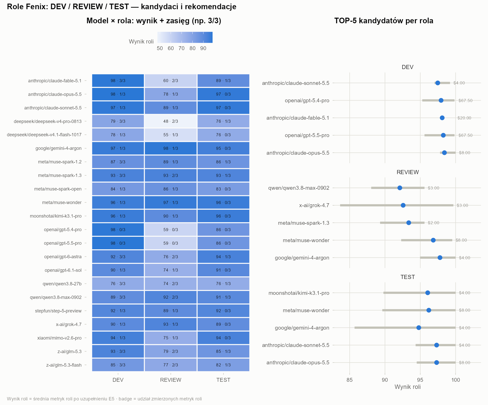

## Rekomendacje w trzech budżetach

```{r}
#| label: fenix-recs-table
#| echo: false
out$fenix_recs_df %>%
  left_join(out$fenix_roles_df %>% select(model_id, role, score_low, score_high),
            by = c("model_id", "role")) %>%
  transmute(
    Rola = role, Budżet = tier, Typ = pick, Model = model_id,
    `Wynik` = paste0(fmt(score), " [", fmt(score_low), "–", fmt(score_high), "]"),
    `Cena $/1M` = paste0("$", fmt(blend_cost, 2)),
    `Pomiarów roli` = n_role_meas,
    `Zasięg (7m)` = paste0(n_meas_7, "/7")
  ) %>% as.data.frame()
```

Trzy poziomy budżetu: **Codzienny kierowca** (≤ $1/1M — model, na którym siedzisz cały dzień), **Słodki punkt / Pareto** (≤ $3/1M — najlepszy stosunek jakości do ceny), **Bezwzględny lider** (no-limit — gdy liczy się tylko wynik). Zasięg (`n_role_meas`) i przedziały `[score_low, score_high]` są częścią rekomendacji: `2/3` za `$0{,}54` bywa lepszym zakładem niż `3/3` niepewnego kandydata za `$2`.

### Interaktywna tabela ról

```{r}
#| label: widget-fenix
#| echo: false
widget_fenix_table(out)
```

## Ocena obecnego stacka Fenixa

```{r}
#| label: stack-table
#| echo: false
stack_df %>%
  transmute(Model = model_id, `Jakość` = fmt(quality), `Rezerwa` = fmt(resid),
            `Med. SPE` = ifelse(is.finite(med_spe), pct(med_spe), "—"),
            `Cena $/1M` = paste0("$", fmt(blend_cost, 2)),
            `Zasięg (7m)` = paste0(n_meas_7, "/7")) %>% as.data.frame()
```

Wnioski z danych: `z-ai/glm-5.3` i `glm-5.3-flash` siedzą tuż pod krzywą cenową z ujemnym `med_spe` (ukryta siła w profilu agentowym), a `xiaomi/mimo-v2.6-pro` jest na fronterze Pareto mimo częściowej imputacji — decyzje o tych modelach podejmuje się jednak z szerszym przedziałem niepewności niż dla modeli w pełni zmierzonych.

## Pełny katalog modeli

Wyszukiwarka po wszystkich 212 modelach: cena (`blend_cost`), jakość, rezerwa, med. SPE, zasięg pomiarowy, role Fenixa i 9 benchmarków:

```{r}
#| label: widget-explorer
#| echo: false
widget_models_explorer_table(out)
```

# Epilog

Projekt zaczął się od chęci powrotu do klasycznej eksploracji danych — a skończył się gotowym systemem decyzyjnym: estymatorem E5 z LOO `r pct(e5$med_abs_spe)` med. błędu, detektorem perełek, taksonomią rynku i widełkami cenowymi dla trzech ról agentowych. Największy wniosek? **75% wariancji jakości nie wyjaśnia cena.** W rynku LLM statystyka wciąż wygrywa z hype — i to jest powód, dla którego warto liczyć, a nie zgadywać.
